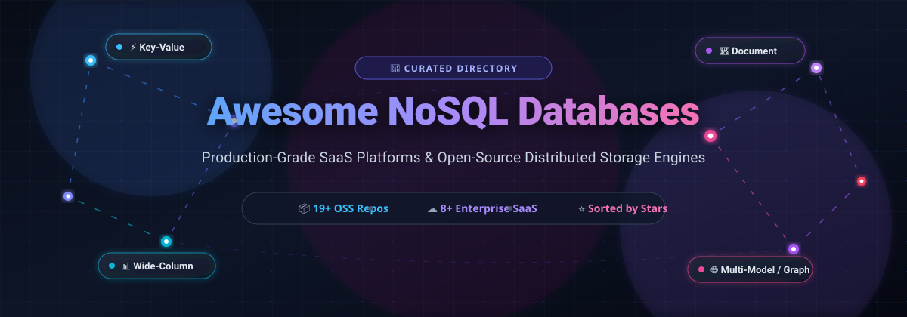

<p align="center">
  
</p>

<p align="center">
  <a href="https://github.com/ishandutta2007/Awesome-Awesome-Awesome"></a>
  <a href="https://discord.gg/jc4xtF58Ve"></a>
  <a href="https://github.com/ishandutta2007/Awesome-Nosql-Databases/stargazers"></a>
  <a href="https://github.com/ishandutta2007/Awesome-Nosql-Databases/network/members"></a>
  <a href="https://github.com/ishandutta2007/Awesome-Nosql-Databases/blob/main/LICENSE"></a>
  <a href="https://github.com/ishandutta2007"></a>
</p>

---

# 🚀 Awesome NoSQL Databases

> **A curated, production-grade guide to enterprise SaaS platforms and top open-source NoSQL databases — spanning Key-Value stores, Document databases, Wide-Column engines, Multi-Model platforms, and Distributed Graph databases.**

Modern web-scale applications, microservices, high-throughput IoT systems, and real-time AI pipelines require data persistence that bypasses the strict schema boundaries and single-primary write bottlenecks of traditional relational RDBMS. This directory provides engineering benchmarks, transparent pricing, free tier thresholds, and architectural trade-offs to help engineers choose the optimal non-relational database.

---

## 📑 Table of Contents

- [🌐 Sector Overview & Market Dynamics](#-sector-overview--market-dynamics)
- [☁️ Top SaaS & Managed NoSQL Platforms](#️-top-saas--managed-nosql-platforms)
- [⚡ Top Open-Source NoSQL Projects](#-top-open-source-nosql-projects)
  - [1. Redis](#1-redis)
  - [2. etcd](#2-etcd)
  - [3. SurrealDB](#3-surrealdb)
  - [4. RocksDB](#4-rocksdb)
  - [5. Dragonfly](#5-dragonfly)
  - [6. MongoDB](#6-mongodb)
  - [7. Valkey](#7-valkey)
  - [8. RethinkDB](#8-rethinkdb)
  - [9. Dgraph](#9-dgraph)
  - [10. Neo4j](#10-neo4j)
  - [11. TiKV](#11-tikv)
  - [12. ScyllaDB](#12-scylladb)
  - [13. ArangoDB](#13-arangodb)
  - [14. Apache Cassandra](#14-apache-cassandra)
  - [15. Apache CouchDB](#15-apache-couchdb)
  - [16. Apache HBase](#16-apache-hbase)
  - [17. Apache Ignite](#17-apache-ignite)
  - [18. RavenDB](#18-ravendb)
  - [19. Aerospike](#19-aerospike)
- [🧭 Architectural Trade-Offs & Decision Matrix](#-architectural-trade-offs--decision-matrix)
- [🤝 How to Contribute](#-how-to-contribute)
- [📈 Star History](#-star-history)
- [💖 Support & Community](#-support--community)
- [⚖️ Disclaimer](#️-disclaimer)

---

## 🌐 Sector Overview & Market Dynamics

The global **NoSQL database market** was valued at approximately **$9.2 billion in 2024** and is projected to expand to **$38.5+ billion by 2030**, advancing at a compound annual growth rate (**CAGR) of 26.8%**. This rapid expansion is fueled by explosive telemetry data, globally distributed cloud-native microservices, generative AI vector/context stores, and mission-critical low-latency caching tiers.

From a market structure perspective, the NoSQL sector displays a **bifurcated competitive dynamic**:
- **Moderately Concentrated at the Cloud Hyperscaler Layer**: Cloud infrastructure giants (**Microsoft Azure Cosmos DB**, **Amazon DynamoDB**) alongside pure-play enterprise document leader **MongoDB Atlas** capture over **65% of total enterprise managed spend**, benefiting from deep vendor lock-in, global data plane integration, and multi-region SLA guarantees.
- **Highly Fragmented & Innovator-Driven in Specialized Workloads**: Outside the hyperscaler core, the landscape is fiercely competitive and fragmented across dedicated workloads. Hardware-accelerated C++/Rust storage engines (**ScyllaDB**, **Dragonfly**), multi-model edge engines (**SurrealDB**, **ArangoDB**), distributed consensus backbones (**etcd**, **TiKV**), and open governance community forks (**Valkey** post-Redis licensing shift) continue to disrupt legacy incumbent architectures.

---

## ☁️ Top SaaS & Managed NoSQL Platforms

The following table details leading fully managed cloud NoSQL services, **sorted descending by company valuation / market capitalization**. All pricing tiers reflect verified base pay-as-you-go or provisioned entry levels, and free tiers outline exact recurring quotas or trial limits.

| 🏢 Platform | 🗄️ Primary Data Model | 💰 Company Valuation / Revenue | 💳 Starting Tier Pricing | 🎁 Free Tier / Trial Quota | 🎯 Best For |
| :--- | :--- | :--- | :--- | :--- | :--- |
| **[Microsoft Azure Cosmos DB](https://azure.microsoft.com/en-us/products/cosmos-db/)** | Multi-Model (Document, Key-Value, Graph, Cassandra, Table) | **~$3.1 Trillion** *(Microsoft Corp. Market Cap)* | **$0.008/hr** per 100 RU/s provisioned (~$5.84/mo baseline); Serverless at **$0.28 per 1M Request Units (RUs)** + $0.25/GB-mo storage | **1,000 RU/s throughput + 25 GB storage free forever** every month; or 30-day free trial with **$200 Azure cloud credits** | Globally distributed enterprise applications requiring multi-API flexibility and single-digit ms SLAs |
| **[Amazon DynamoDB](https://aws.amazon.com/dynamodb/)** | Key-Value & Document | **~$2.2 Trillion** *(Amazon.com Inc. Market Cap)* | On-Demand: **$1.25 per 1M write units** & **$0.25 per 1M read units**; Provisioned: **$0.00065/hr per WCU** and **$0.00013/hr per RCU** | **25 GB storage + 25 WCU + 25 RCU free forever** (sufficient for up to 200 million requests/month on AWS Free Tier) | AWS-native microservices, gaming state stores, and serverless architectures with well-known primary key patterns |
| **[MongoDB Atlas](https://www.mongodb.com/products/platform/atlas-database)** | Document (BSON/JSON) | **~$20.5 Billion** *($2.0B+ ARR, NASDAQ: MDB)* | Shared M2 tier at **$9.00/month** (2 GB storage, 512 MB RAM) or Dedicated M10 cluster at **$0.08/hr** (~$57/month for 10 GB storage, 2 GB RAM) | **M0 Sandbox free forever** with 512 MB storage, shared RAM/vCPU, and up to 100 concurrent connections (no credit card required) | Rich JSON document applications, rapid schema evolution, and teams wanting the largest document ecosystem |
| **[Redis Cloud](https://redis.io/cloud/)** | In-Memory Key-Value & Data Structures | **~$4.0 Billion** *($150M+ ARR)* | Fixed Essentials starting at **$5.00/month** (250 MB memory, 1 database); Pay-as-you-go Pro starting at **$0.0105/hour** | **30 MB database free forever** across AWS, GCP, or Azure with 1 database, 30 concurrent connections, and 24/7 availability | Ultra-fast caching, session storage, leaderboard computations, and sub-millisecond pub/sub streaming |
| **[DataStax Astra DB](https://www.datastax.com/products/datastax-astra)** | Wide-Column & Vector (Cassandra-native) | **~$1.6 Billion** *($150M+ ARR)* | Serverless pay-as-you-go: **$0.25 per 1M read ops**, **$1.25 per 1M write ops**, and **$0.25/GB-mo storage** | **$25.00 recurring credit every month free forever** (~80M reads, ~20M writes, and 100 GB storage without charge) | Trillion-scale write workloads, globally replicated time-series, and GenAI retrieval-augmented generation (RAG) |
| **[Couchbase Capella](https://www.couchbase.com/products/capella/)** | Document with N1QL (SQL for JSON) & Key-Value | **~$1.0 Billion** *($200M+ ARR, NASDAQ: BASE)* | Basic tier from **$0.07/hr per node** (~$51/mo/node) or Developer Pro from **$0.198/hr per node** (~$144/mo/node) | **30-day free trial** with 1 fully configured 3-node cluster and Capella iQ GenAI assistance (no credit card required) | Enterprise document modeling with familiar SQL querying, indexing, and mobile edge synchronization |
| **[ScyllaDB Cloud](https://www.scylladb.com/product/scylladb-cloud/)** | Wide-Column & Key-Value (Cassandra/DynamoDB API) | **~$400 Million** *($45M+ Series C funding)* | Serverless at **$0.15 per 1M ops** + $0.08/GB-mo storage; Dedicated clusters starting at **$0.46/hr** (~$335/month for 3 nodes) | **30-day free trial** with **$250 cloud credits** supporting full multi-node cluster provisioning (no credit card required) | High-throughput CQL/DynamoDB workloads hitting JVM GC pauses and seeking 10x throughput per node |
| **[Fauna](https://fauna.com/)** | Document-Relational / Multi-Model (FQL) | **~$200 Million** *($57M venture funding)* | Compute Ops from **$0.15 per 100K ops**, Storage from **$0.25/GB-month**, and Data Transfer at **$0.15/GB** | **Free forever Developer plan** with 5 GB storage, 100K compute ops/month, and 5 GB monthly data transfer | Serverless modern web/mobile apps requiring strict ACID transactions and strongly consistent distributed queries |

---

## ⚡ Top Open-Source NoSQL Projects

Below are the most prominent open-source NoSQL databases, **ranked strictly by GitHub Stars_Count (descending)**. Every repository badge links directly to its stargazer community.

---

### 1. [Redis](https://github.com/redis/redis) [](https://github.com/redis/redis/stargazers)
- **Primary Model**: In-Memory Key-Value Data Structure Store
- **License**: RSALv2 / SSPLv1 (Dual source-available since 2024; previously BSD-3-Clause)
- **Architecture**: Single-threaded event loop (with threaded I/O), in-memory storage with optional RDB snapshots and AOF persistence, Redis Cluster for horizontal partitioning.
- **Key Strengths**: Sub-millisecond latency; native data structures including Hashes, Sorted Sets, Bitmaps, HyperLogLogs, Geospatial indexes, and Streams.
- **Trade-offs**: RAM-constrained storage cost; single-core command execution bottleneck for CPU-intensive operations; 2024 license departure from OSI open-source sparked industry forks.
- **Best For**: High-throughput caching, session management, real-time message queuing, and dynamic leaderboards.

---

### 2. [etcd](https://github.com/etcd-io/etcd) [](https://github.com/etcd-io/etcd/stargazers)
- **Primary Model**: Distributed Consistent Key-Value Store
- **License**: Apache-2.0
- **Architecture**: Built in Go using the Raft consensus algorithm; linearizable reads and sequential writes across an odd-numbered quorum cluster.
- **Key Strengths**: Rock-solid data consistency guarantees; native watch API with long-polling/gRPC event streaming; the operational backbone of Kubernetes cluster state and service configuration.
- **Trade-offs**: Not engineered for high-volume general application payloads; strict 8 GB maximum recommended database size; write throughput bound by quorum disk fsync.
- **Best For**: Distributed coordination, leader election, feature flagging, dynamic service discovery, and cloud-native infrastructure control planes.

---

### 3. [SurrealDB](https://github.com/surrealdb/surrealdb) [](https://github.com/surrealdb/surrealdb/stargazers)
- **Primary Model**: Multi-Model (Document, Graph, Key-Value, Time-Series, Vector)
- **License**: Business Source License (BSL 1.1), converting to Apache-2.0
- **Architecture**: Written in Rust; pluggable storage backends (memory, RocksDB, TiKV, FoundationDB); declarative SQL-like query language (SurrealQL) with built-in permissions and real-time live queries.
- **Key Strengths**: Unifies tabular, document, and graph paradigms into one query surface; native client authentication and granular row-level security allowing direct frontend-to-database connections.
- **Trade-offs**: Relatively newer production maturity compared to decade-old engines; evolving query optimizer for complex multi-hop joins across petabyte scales.
- **Best For**: Full-stack web/mobile apps, real-time collaborative applications, graph-enhanced document systems, and GenAI vector retrieval.

---

### 4. [RocksDB](https://github.com/facebook/rocksdb) [](https://github.com/facebook/rocksdb/stargazers)
- **Primary Model**: Embedded Persistent Key-Value Store
- **License**: Apache-2.0 / GPL-2.0
- **Architecture**: C++ implementation based on Log-Structured Merge (LSM) trees, optimized for fast flash storage (NVMe SSDs) and multi-core CPU architectures.
- **Key Strengths**: Unrivaled sequential write performance; highly configurable compaction algorithms and block caches; the core embedded storage engine powering TiKV, Kafka Streams, Ceph, and CockroachDB.
- **Trade-offs**: Embedded library without network server or client protocol out of the box; write amplification and read amplification during intensive LSM compaction passes.
- **Best For**: Building custom high-performance storage engines, stateful stream processing backends, and low-latency embedded applications.

---

### 5. [Dragonfly](https://github.com/dragonflydb/dragonfly) [](https://github.com/dragonflydb/dragonfly/stargazers)
- **Primary Model**: In-Memory Key-Value Store (Redis & Memcached Drop-In)
- **License**: Business Source License (BSL 1.1)
- **Architecture**: Multi-threaded shared-nothing architecture using the Seastar async framework and customized distributed lock algorithms; runs on modern multi-core x86/ARM servers.
- **Key Strengths**: Up to 25x the throughput of standard Redis; handles millions of queries per second per server; vertical scaling that saturates all host CPU cores and RAM without cluster management complexity.
- **Trade-offs**: Source-available BSL license; newer operational tooling and backup ecosystem compared to legacy Redis tooling.
- **Best For**: High-density in-memory caching requiring millions of QPS per node, eliminating Redis cluster sharding overhead.

---

### 6. [MongoDB](https://github.com/mongodb/mongo) [](https://github.com/mongodb/mongo/stargazers)
- **Primary Model**: Document Store (JSON/BSON)
- **License**: Server Side Public License (SSPL v1, non-OSI compliant)
- **Architecture**: Replica sets with single-primary electable architecture for high availability; sharding through `mongos` routing instances and config servers; WiredTiger storage engine.
- **Key Strengths**: Ubiquitous developer mindshare; comprehensive aggregation pipeline framework; native secondary, geospatial, text, and vector indexes; per-document schema flexibility.
- **Trade-offs**: 16 MB maximum single document limit; single-primary write bottleneck per replica set; SSPL license restricts SaaS cloud hosting of the community edition.
- **Best For**: Enterprise content management, e-commerce product catalogs, rapid prototyping, and general-purpose microservice persistence.

---

### 7. [Valkey](https://github.com/valkey-io/valkey) [](https://github.com/valkey-io/valkey/stargazers)
- **Primary Model**: In-Memory Key-Value & Data Structures
- **License**: BSD-3-Clause (Open Source under the Linux Foundation)
- **Architecture**: True community-governed open-source fork of Redis 7.2.4; multi-core threaded I/O enhancements, cluster slot migration optimizations, and drop-in protocol compatibility.
- **Key Strengths**: 100% API and command compatibility with Redis clients; backed by major cloud providers (AWS, Google Cloud, Oracle, Ericsson); guaranteed permissive open-source governance.
- **Trade-offs**: Brand-new organization spun out in spring 2024; legacy Redis documentation and certifications take time to formally transition.
- **Best For**: Teams and organizations requiring strict OSI-compliant licensing for caching, messaging, and distributed in-memory data structures.

---

### 8. [RethinkDB](https://github.com/rethinkdb/rethinkdb) [](https://github.com/rethinkdb/rethinkdb/stargazers)
- **Primary Model**: Realtime Document Database (JSON)
- **License**: Apache-2.0 (Community governed through Linux Foundation)
- **Architecture**: Distributed cluster with table-level sharding; ReQL functional query language; Changefeeds streaming architecture pushing database changes directly to subscribers.
- **Key Strengths**: Native Changefeeds make building reactive push-based real-time web applications effortless; elegant intuitive web management UI built into the engine.
- **Trade-offs**: Slower write throughput under sustained heavy loads compared to MongoDB; smaller developer ecosystem and slower release velocity.
- **Best For**: Live dashboards, collaborative editing tools, notification engines, and real-time IoT status feeds.

---

### 9. [Dgraph](https://github.com/dgraph-io/dgraph) [](https://github.com/dgraph-io/dgraph/stargazers)
- **Primary Model**: Distributed Native Graph Database
- **License**: Apache-2.0
- **Architecture**: Written in Go; native GraphQL query engine executed via BadgerDB LSM storage; distributed Raft clusters separating Alpha query nodes from Zero coordinator nodes.
- **Key Strengths**: Native GraphQL-first design; horizontally scalable graph traversals without master bottlenecks; distributed ACID transactions.
- **Trade-offs**: Memory intensive on large predicate indexes; complex multi-node cluster operations during rebalancing.
- **Best For**: Knowledge graphs, fraud detection networks, social topology analyzers, and identity graph mapping.

---

### 10. [Neo4j](https://github.com/neo4j/neo4j) [](https://github.com/neo4j/neo4j/stargazers)
- **Primary Model**: Property Graph Database
- **License**: GPL-3.0 (Community Edition)
- **Architecture**: Native graph processing engine with index-free adjacency (nodes point directly to related nodes without index lookups); Cypher declarative graph query language.
- **Key Strengths**: Gold standard for complex graph algorithms (PageRank, shortest path, community detection); rich visualization tools (Neo4j Bloom) and deep data science library integrations.
- **Trade-offs**: Community edition lacks native horizontal scale-out clustering (enterprise feature); memory footprint requires careful JVM heap and page cache tuning.
- **Best For**: Deep relationship querying, master data management, recommendation engines, and cybersecurity attack path modeling.

---

### 11. [TiKV](https://github.com/tikv/tikv) [](https://github.com/tikv/tikv/stargazers)
- **Primary Model**: Distributed Transactional Key-Value Store
- **License**: Apache-2.0 (CNCF Graduated Project)
- **Architecture**: Written in Rust; multi-Raft group consensus; RocksDB storage engine at node level; dynamic data sharding by byte ranges with Placement Driver (PD) orchestration.
- **Key Strengths**: True distributed ACID transactions (Google Percolator model); elastic horizontal scaling without downtime; proven in petabyte-scale financial deployments as the storage layer for TiDB.
- **Trade-offs**: Significant operational complexity requiring dedicated Placement Driver nodes; higher latency overhead for small single-node datasets.
- **Best For**: Cloud-native infrastructure requiring strongly consistent, high-scale distributed transactional key-value persistence.

---

### 12. [ScyllaDB](https://github.com/scylladb/scylladb) [](https://github.com/scylladb/scylladb/stargazers)
- **Primary Model**: Wide-Column & Key-Value (Cassandra & DynamoDB API compatible)
- **License**: AGPL-3.0 (Community Edition) / Apache-2.0 drivers
- **Architecture**: Implemented from scratch in C++ using the shared-nothing, thread-per-core Seastar framework; direct kernel bypass async I/O (`io_uring`).
- **Key Strengths**: Complete elimination of JVM garbage collection latency spikes; p99 latencies consistently under 5ms at millions of QPS; drop-in CQL and Alternator (DynamoDB) compatibility.
- **Trade-offs**: Hardware-demanding architecture that performs best on modern multi-core NVMe SSD systems; AGPL license for self-hosted community version.
- **Best For**: Large-scale Cassandra or DynamoDB workloads seeking substantial hardware consolidation and strict p99 latency guarantees.

---

### 13. [ArangoDB](https://github.com/arangodb/arangodb) [](https://github.com/arangodb/arangodb/stargazers)
- **Primary Model**: Native Multi-Model (Document, Graph, Key-Value, Search)
- **License**: Apache-2.0
- **Architecture**: C++ core utilizing RocksDB storage engine; unified ArangoDB Query Language (AQL) capable of combining document filtering, graph traversals, and full-text search in a single query.
- **Key Strengths**: Single engine eliminates data synchronization overhead between separate document, search, and graph stores; native ACID transactions across collections.
- **Trade-offs**: Query performance on specialized workloads may trail dedicated single-purpose graph or search engines; cluster configuration requires operational vigilance.
- **Best For**: Multi-faceted enterprise applications requiring simultaneous graph relationship analysis and JSON document querying.

---

### 14. [Apache Cassandra](https://github.com/apache/cassandra) [](https://github.com/apache/cassandra/stargazers)
- **Primary Model**: Distributed Wide-Column Store
- **License**: Apache-2.0
- **Architecture**: Fully decentralized peer-to-peer ring architecture with no master node (no single point of failure); consistent hashing partition ring; tunable consistency (ONE, QUORUM, ALL) per query.
- **Key Strengths**: Unmatched linear write scalability (adding nodes linearly increases throughput); battle-tested at trillion-operation scale at Netflix, Apple, and Discord; multi-datacenter cross-region replication built in.
- **Trade-offs**: CQL does not support relational joins, subqueries, or cross-partition transactions; primary key modeling must precede query formulation; JVM GC tuning required.
- **Best For**: Time-series telemetry, write-heavy ingestion pipelines, event logging, and mission-critical multi-region deployments.

---

### 15. [Apache CouchDB](https://github.com/apache/couchdb) [](https://github.com/apache/couchdb/stargazers)
- **Primary Model**: Offline-First Multi-Master Document Store (JSON)
- **License**: Apache-2.0
- **Architecture**: Built in Erlang/OTP for concurrency and fault tolerance; append-only B-tree storage format; RESTful HTTP/JSON API; peer-to-peer bidirectional replication protocol with automatic conflict tracking.
- **Key Strengths**: Seamless synchronization with in-browser/mobile **PouchDB**; offline-first local data storage that automatically syncs when network connectivity returns; no proprietary driver required.
- **Trade-offs**: MapReduce view re-indexing can be compute heavy; write throughput is lower than LSM-tree based engines.
- **Best For**: Mobile applications operating in intermittently disconnected environments, edge gateways, and distributed offline-first clients.

---

### 16. [Apache HBase](https://github.com/apache/hbase) [](https://github.com/apache/hbase/stargazers)
- **Primary Model**: Distributed Wide-Column Store (Google Bigtable Model)
- **License**: Apache-2.0
- **Architecture**: Runs directly on top of the Hadoop Distributed File System (HDFS); coordinated via Apache ZooKeeper; RegionServer architecture providing sorted key-value access.
- **Key Strengths**: Real-time random read/write access to billions of rows and millions of columns across petabyte Hadoop clusters; strong consistency for single-row mutations.
- **Trade-offs**: Heavy infrastructure footprint requiring HDFS, ZooKeeper, and Java runtime; high operational overhead for small-to-medium teams.
- **Best For**: Large enterprise big-data analytical pipelines requiring real-time random access over massive HDFS lakehouses.

---

### 17. [Apache Ignite](https://github.com/apache/ignite) [](https://github.com/apache/ignite/stargazers)
- **Primary Model**: In-Memory Data Grid & Distributed Key-Value Store
- **License**: Apache-2.0
- **Architecture**: In-memory computing platform with tiered storage (RAM + optional native persistence on disk); distributed ACID transactions; ANSI-99 SQL query engine.
- **Key Strengths**: Combines in-memory key-value speed with full SQL join capabilities; distributed compute grid running co-located compute tasks directly alongside stored data partitions.
- **Trade-offs**: Heavy memory consumption; complex clustering and topology management.
- **Best For**: High-frequency financial trading, real-time risk calculations, and accelerating legacy relational databases via in-memory caching grids.

---

### 18. [RavenDB](https://github.com/ravendb/ravendb) [](https://github.com/ravendb/ravendb/stargazers)
- **Primary Model**: ACID Document Database (JSON)
- **License**: AGPL-3.0 (Community Edition) / Commercial
- **Architecture**: Written in C#/.NET; Voron transactional storage engine; multi-master distributed clustering; automatic indexing engine via background machine indexing.
- **Key Strengths**: Native ACID transactions across multiple documents and collections; built-in Raven Query Language (RQL) and native full-text search; zero-administration self-tuning indexes.
- **Trade-offs**: Smaller community footprint than MongoDB; AGPL license for self-hosted community deployments.
- **Best For**: .NET and enterprise ecosystems requiring turnkey, transactional JSON document storage without operational overhead.

---

### 19. [Aerospike](https://github.com/aerospike/aerospike-server) [](https://github.com/aerospike/aerospike-server/stargazers)
- **Primary Model**: Flash-Optimized Real-Time Key-Value & Document Store
- **License**: AGPL-3.0 (Community Edition) / Apache-2.0 client drivers
- **Architecture**: Hybrid Memory Architecture (HMA) storing primary index in DRAM while data blocks reside directly on raw NVMe SSDs; bypasses Linux filesystem block layers.
- **Key Strengths**: Predictable sub-millisecond read/write latency at petabyte scale while using a fraction of the DRAM required by pure in-memory systems; exceptional cost efficiency per transaction.
- **Trade-offs**: Optimized specifically for high-spec SSD hardware; custom secondary indexing and expression syntax.
- **Best For**: Real-time programmatic ad bidding (RTB), high-volume fraud detection, telecommunications customer 360, and recommendation engines.

---

## 🧭 Architectural Trade-Offs & Decision Matrix

When selecting a NoSQL database, architecture dictates performance and developer ergonomics. Use this matrix to navigate trade-offs:

| Requirement / Workload Pattern | Recommended Database Engines | Architecture Rationale |
| :--- | :--- | :--- |
| **Hot In-Memory Caching & Sessions** | **Valkey**, **Redis**, **Dragonfly** | Microsecond response times, rich native data structures, simple key lookup. |
| **Rapid Iteration & JSON Documents** | **MongoDB**, **Azure Cosmos DB**, **Couchbase** | Dynamic schema flexibility, expressive aggregation pipelines, rich ecosystem tooling. |
| **Trillion-Scale Write Ingestion / Logs** | **Apache Cassandra**, **ScyllaDB**, **DynamoDB** | Masterless linear write scaling, consistent hash partitioning, zero single points of failure. |
| **Offline-First & Mobile Sync** | **Apache CouchDB** *(with PouchDB)* | Bidirectional peer-to-peer replication with deterministic revision conflict resolution. |
| **Complex Relationship & Graph Analysis** | **Neo4j**, **Dgraph**, **ArangoDB** | Index-free adjacency, native traversal algorithms, declarative Cypher/GraphQL query execution. |
| **Distributed Control Plane State** | **etcd**, **TiKV** | Raft-backed linearizable consistency, high availability quorum, atomic compare-and-swap primitives. |
| **High-Throughput SSD / NVMe Storage** | **Aerospike**, **RocksDB**, **ScyllaDB** | Direct SSD bypass, LSM-tree sequential writes, shard-per-core CPU saturation. |

---

## 🤝 How to Contribute

Contributions are warmly welcomed! Help keep this directory accurate, neutral, and comprehensive:

1. **Fork the Repository**: Click the `Fork` button at the top right of this page.
2. **Create a Feature Branch**:
   ```bash
   git checkout -b feature/add-new-database
   ```
3. **Add or Update Entries**:
   - Provide factual, vendor-neutral technical summaries.
   - For SaaS products: include specific entry pricing, free tier thresholds, and company valuation/revenue metrics.
   - For open-source repos: include Stars_Badges linking to `/stargazers`, correct licensing, and architectural trade-offs.
4. **Submit a Pull Request**: Provide a clear explanation of additions and cite authoritative documentation.

---

## 📈 Star History

[](https://star-history.dera.page/#ishandutta2007/Awesome-Nosql-Databases&type=date&legend=top-left)

---

## 💖 Support & Community

Thank you for visiting and using **Awesome-Nosql-Databases**! If this repository helped you evaluate, benchmark, or architect your database infrastructure, please consider supporting the project:

- ⭐ **Star the Repository**: Help more developers and architects discover this resource.
- 🍴 **Fork & Share**: Share it with your engineering team, LinkedIn network, or tech community.
- 💬 **Join the Discussion**: Connect with fellow builders on our [Discord Community](https://discord.gg/jc4xtF58Ve).
- ☕ **Sponsor the Maintainer**: Support ongoing open-source curation via the [GitHub Sponsor Dashboard](https://github.com/sponsors/ishandutta2007).

---

## ⚖️ Disclaimer

- This directory is a **community-curated engineering resource** — entries are listed for technical evaluation and do not constitute an endorsement.
- All product names, logos, trademarks, and registered trademarks are property of their respective owners.
- Pricing models, free tier quotas, and corporate valuations fluctuate; always consult official vendor documentation for up-to-date commercial terms.
